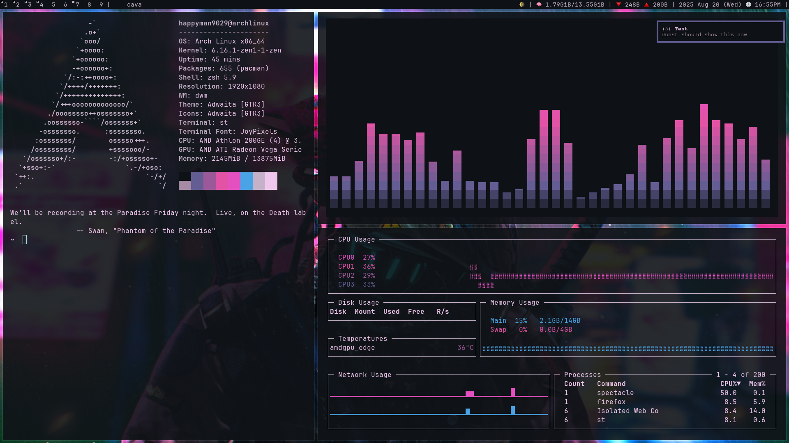
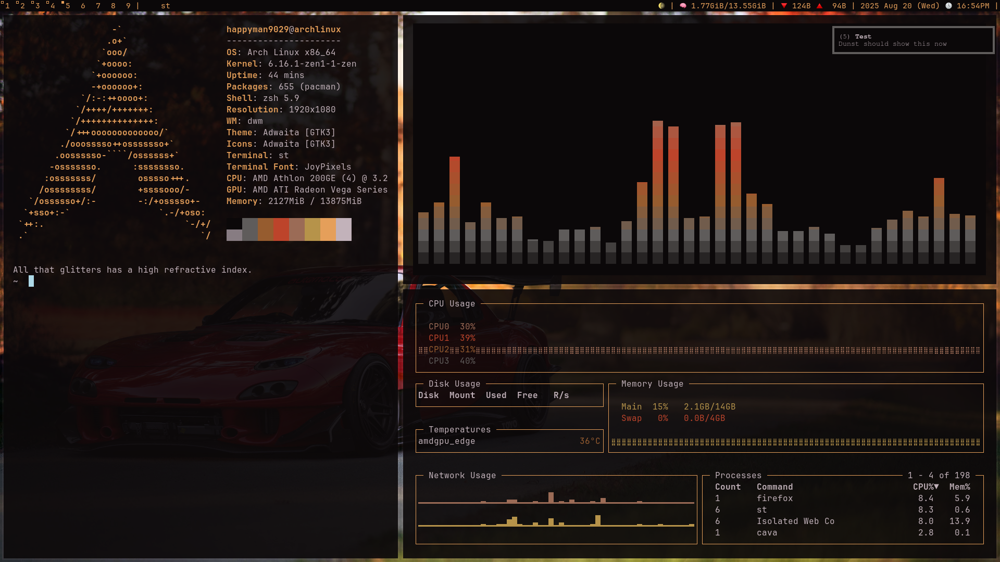
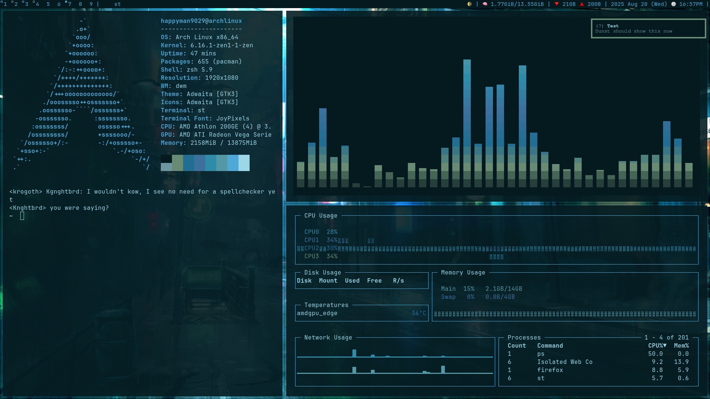
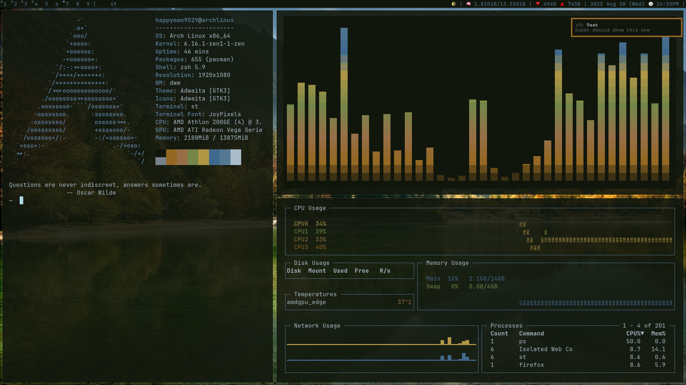
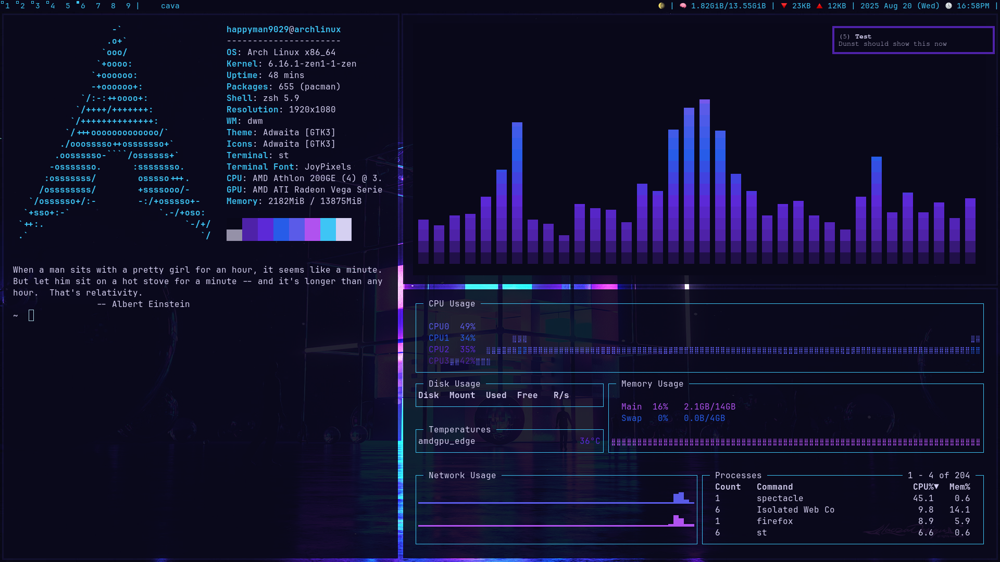

# 🌌 Auto Wallpaper Themer  

**Give your desktop a fresh look every time.** 

**Auto-randomize** your wallpapers in yours **specified folder** and set the randomized one as your current desktop wallpaper along with **auto-generated pywall colors** corresponding to the wallpaper, which also applies colors to **Dunst** notify and **Cava** audio visualizer by using [Pywal](https://github.com/dylanaraps/pywal).  

Watch on Youtube- https://youtu.be/IRB67VRYY6w?si=D5IpwRDTwqvJMz_E

---

## ✨ Features
- 🖼️ **Random Wallpaper Picker** – grabs wallpapers from your folder  
- 🎨 **Pywal Color Schemes** – generates matching terminal themes  
- 🔔 **Dunst Integration** – notifications styled to match  
- 🎵 **Cava Visualizer Sync** – reactive colors tied to wallpaper  
- ⚡ **Fully Automated** – one script, cohesive aesthetics  

---

## 📸 Screenshots
  
  
  
  
  

🔗 [Check out the wallpapers used →](assets/)  

---

## ⚙️ Installation & Usage  
## ⚠️ Reminder to update the wallpaper folder path inside the script. 
### ▶️ Make the script executable and run it:
```
git clone https://github.com/happyman09/auto-wallpaper-themer.git
cd auto-wallpaper-themer
chmod +x pywallpaper.sh
./pywallpaper.sh
```
---

## 🔄 Auto-start on login
To run the script automatically when X starts, add this to your ~/.xinitrc:
```~/path/to/script/pywallpaper.sh &```

---

## ⚠️ Setup Requirements:
### Before running, copy both configs to your Cava directory:
```cp config.base config ~/.config/cava/```

**`config.base`** → template Cava config (edit defaults here)

**`config`** → dynamically overwritten by the script

---

## 📦 Dependencies
Make sure the following are installed:
- `jq`
- `pywal`
- `xwallpaper`
- `xdotool`
- `libnotify`
- `cava`
- `dunst`

---

## 📝 Notes
- Works best on Xorg (Wayland support is limited)
- Customize `config.base` for your Cava defaults
- The script auto-updates `config` on each wallpaper change for Cava

## 🌐 Ecosystem Integration
**Auto-Wallpaper-Themer plays nicely with my suckless setup:**

🖥️ **`dwm`** – https://github.com/happyman09/dwm.git

⌨️ **`st`** (Simple Terminal) – https://github.com/happyman09/st.git

📊 **`dwmblocks`** – https://github.com/happyman09/dwmblocks.git

🧭 **`dmenu`** – https://github.com/happyman09/dmenu.git

---

## 🤝 Contributing
Got ideas or fixes? PRs are welcome. Open an issue first to discuss big changes. 

## 📜 License
MIT License – feel free to use, modify, and share.

---
